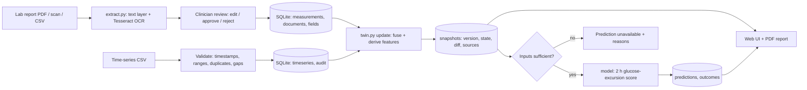

# Architecture

Layers: `naari/twin.py` (engine, schema), `naari/model.py` (task, training, metrics), `naari/extract.py`, `naari/records.py`, `naari/server.py` (stdlib HTTP + JSON API, cookie sessions), `web/index.html` (single-page UI, inline SVG charts). Designed so the engine can later sit behind FastAPI/React unchanged.
